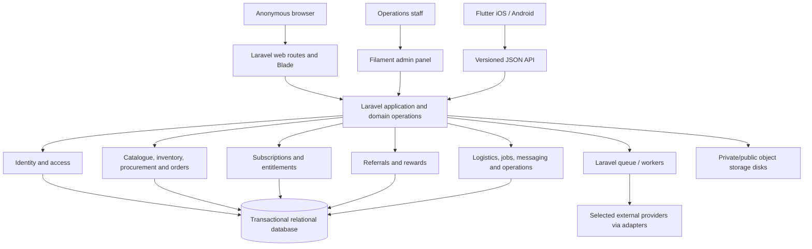

# OgaFarm Technical Architecture

**Status:** Proposed architecture based on the repository and OgaFarm v60
**Prepared:** 13 November 2026
**Scope:** Laravel web application and future Flutter clients
**Decision rule:** This document recommends boundaries and implementation order. It does not select unapproved vendors, settle open product policies, or claim proposed features are implemented.

## 1. Executive summary

OgaFarm is currently an early Laravel 13 modular-monolith skeleton. It has Laravel Blade views, a Filament admin panel provider, authentication and referral flows, domain-oriented migrations and Eloquent models, and one referral service. The route surface and tests remain small. Products, orders, subscriptions, logistics, jobs, messaging, disputes and audit mostly have schema/model scaffolding rather than complete user-facing workflows.

The practical target is to keep one Laravel application and one transactional relational database while organizing code by domain. Provide:

- Blade-rendered, anonymous public pages and authenticated web journeys.
- A versioned JSON API (`/api/v1`) over the same application/domain operations for Flutter.
- A distinct, explicitly authorized Filament operations panel.
- Database transactions for money, entitlements, reservations and state changes; queued work for notifications and other non-request work.
- Provider adapters only after the project owner selects external providers.

Do not split into microservices or create a separate API application now. That would add operational and consistency costs without evidence of a current scaling need.

## 2. Inspection basis and current implementation

### Repository facts

- Runtime requirements declare PHP `^8.3` and Laravel `^13.17`; installed versions reported by Composer are PHP-compatible Laravel Framework **13.42.0**, Filament **5.11.2**, Sanctum **4.4.0**, and PHPUnit **12.5.43**.
- The frontend is Blade with Tailwind CSS 4 and Vite 8. `resources/views` contains landing, login/register/verification, role dashboards, and a subscription-plan view.
- The default configured database connection is SQLite (`database/database.sqlite`). MySQL, MariaDB and PostgreSQL connection definitions also exist; the project does not identify a production database.
- Sanctum is installed, but `User` does not use `HasApiTokens`; `bootstrap/app.php` registers web and console routes, not an API route file.
- `routes/web.php` exposes 12 application routes: landing, invite, registration/login/logout, email verification, dashboard, and subscription plans. `routes/subscriptions.php` explicitly describes checkout and webhooks as future work.
- `app/Enums/Role.php` defines farmer, supplier, buyer, group buyer, diaspora buyer, transporter, job seeker, consultant and admin. Registration currently permits only farmer, supplier, buyer, transporter and job seeker.
- Domain migrations cover identity/roles, verification, subscriptions/payments, referrals/rewards, storefronts/products/inventory events, RFQs/quotes/orders, group orders, logistics, jobs/markets, messaging, disputes, notification preferences and audit events.
- Models are grouped into a small number of multi-class files. The only domain service is `ReferralRewardService`.
- `EnsureRole` exists, but no current web route uses it. No application policies or Gates were found. Filament is configured at `/admin` with login middleware; no app-level panel eligibility method or domain-specific admin authorization was found.
- Email verification and Laravel intended redirects exist. The invite handler stores a referral code in session and redirects to registration; other shareable public detail routes are not present.
- No Flutter/Dart application, public storefront/product routes, JSON API controllers, payment webhook handler, domain jobs, scheduler task, or provider integration was found.
- The feature and unit test suites each contain an example test only. `php artisan test --compact` passes **2 tests / 2 assertions**, which does not verify the domain workflows.
- The README says the handoff is a proposal, records the v60 subscription amounts and referral rules, and lists open product/provider/infrastructure decisions. It describes an architecture supplement as v59; this repository does not include that separate source document.

### Relevant inputs reviewed

`README.md`, `AGENTS.md`, `CLAUDE.md`, `.github/copilot-instructions.md`, and the custom project-manager, solution-architect, backend, Flutter, billing/referrals, marketplace, security/DevOps, QA, web-frontend, researcher and debugger agent instructions were reviewed. Those instructions consistently require actual repository evidence, server-side authorization, safe payment/reward processing, approval for unresolved policies, and truthful reporting of implementation/test status.

### Important implementation caveats

These are architectural readiness risks, not a claim that the current project is production-ready:

1. The enum and model setup needs a relationship/type review before relying on it. For example, `User::roles()` attempts a many-to-many relation using the role enum rather than a role model, while `hasRole()` independently queries `UserRole`. Some relation return types in the grouped model files also lack imports. Existing example tests do not exercise these paths.
2. `ReferralRewardService` contains core grant/reversal logic, but there is no observed caller, webhook, scheduled evaluator or test suite around it. Its 30-day attribution window is encoded in code even though the README marks approval of that policy as open. Its reversal path updates the existing ledger row and decrements lifetime counters; that needs reconciliation with the v60 lifetime-cap and auditable-reversal intent before production use.
3. `Product::reserveStock()` uses a database transaction and row lock, but no order workflow calls it. There is no reservation expiry/release lifecycle. SQLite is the configured default and should not be treated as evidence that production locking behavior is settled.
4. Payment/event and audit tables exist, but no webhook signature verification, provider-event processing, reconciliation or immutable audit write path was found. Provider names in migration comments are examples, not provider selection.
5. Subscription plan amounts are present in an enum as floating-point values and rendered in Blade. Keep the v60 values unchanged; before payment implementation, represent money consistently in fixed precision/minor units and derive checkout amounts from server-owned plan definitions.
6. Verification document path fields and local/private/public storage disks exist, but there is no verified upload/access workflow. Sensitive documents must never be exposed via the public disk.

## 3. Target architecture

Keep the current deployable Laravel application as a **modular monolith**. Domains own their models, actions, validation, authorization and routes; they share the application database but should not directly mutate another domain’s aggregate outside its public operation.



The existing Blade app and the future mobile API should call the same application/domain operations; do not duplicate business rules in controllers or in Flutter. Keep public pages server-rendered and anonymous where content is approved. A public share URL should resolve in a browser even when the app is not installed.

### Data ownership and boundaries

| Domain | Owns and enforces | Existing starting points |
|---|---|---|
| Identity & access | User identity, role assignments, verification status, permissions, sessions/tokens, account lifecycle | `User`, `UserRole`, `Verification`, `Role`, identity migration, auth controllers |
| Storefront & catalogue | Storefront profiles, public visibility/moderation, product descriptions, prices, units and availability | `Storefront`, `StorefrontCategory`, `Product`, catalogue migration |
| Inventory | Available/reserved/sold quantities, reservation lifecycle, movement history | `Product::reserveStock()`, `InventoryEvent` |
| Procurement & orders | RFQs, quotes, order snapshots, participant access, allowed order transitions and cancellation/refund requests | `Rfq`, `Quote`, `Order`, `OrderItem`, procurement migration |
| Group buying | Group terms, membership/contributions, cutoff, funding state, allocation and cancellation | `GroupOrder`, `GroupMember` |
| Billing & entitlements | Server-authoritative plans, payment events, paid periods and entitlement change history | `Subscription`, `PaymentEvent`, `EntitlementEvent`, plan enum |
| Referrals & rewards | Attribution record, eligibility, validation hold, lifetime grant counter, grant/reversal ledger | `Referral`, `RewardEntitlement`, `RewardLedger`, `ShareEvent`, `ReferralRewardService` |
| Logistics | Transporter/vehicle verification, quotes, assignments, delivery and proof metadata | `Transporter`, `Vehicle`, `TransportQuote`, `Delivery` |
| Jobs & markets | Job postings/applications, consultant treatment when approved, market and price submissions/moderation | `JobPosting`, `Application`, `Market`, `MarketPrice` |
| Messaging & notifications | Conversation membership, message privacy, notification preferences/consent and delivery status | `Conversation`, `Message`, `NotificationPreference` |
| Operations | Disputes, moderation decisions and audit history; admin commands use the owning domain operation | `Dispute`, `AuditEvent`, Filament panel provider |

Keep these boundaries as code boundaries, not separate services. Add cross-domain services/events only where a real workflow needs coordination. For important external side effects, commit domain state first and queue work after commit; choose a transactional outbox only if operational requirements need guaranteed delivery beyond the selected queue/database behavior.

## 4. Proposed Laravel structure

Retain Laravel conventions and evolve incrementally. This is a target for new/refactored code, not a request for a large directory rewrite:

```text
app/
  Domain/
    Identity/          # actions, policies, domain-specific queries
    Catalogue/
    Inventory/
    Procurement/
    Billing/
    Referrals/
    Logistics/
    JobsMarkets/
    Messaging/
  Http/
    Controllers/
      Web/
      Api/V1/
      Admin/           # only if custom admin endpoints are needed
    Middleware/
    Requests/
    Resources/
  Models/              # one Eloquent model per file; existing models migrate gradually
  Policies/
  Providers/
    Filament/
  Jobs/
  Notifications/
routes/
  web.php
  api.php              # register explicitly in bootstrap when approved/implemented
  console.php
  domains/             # optional route includes only when route volume warrants
tests/
  Feature/
  Unit/
```

Do not create a service class for every model. Use focused action/use-case classes for multi-step writes (e.g. creating an order and reserving stock), policies for record authorization, Form Requests for HTTP validation, and API Resources for response shapes. Keep simple read-only Eloquent queries close to their controller/query object until complexity justifies extraction. Split the current multi-model files gradually into one class per file so autoloading, navigation and tests are predictable.

## 5. Mobile API proposal

All endpoints below are proposals. They are not existing routes or a finalized API contract. Start with `/api/v1`; define a written request/response contract and error format before the Flutter client depends on it.

### Authentication and common behavior

- Use Laravel’s session guard and CSRF protection for browser web flows.
- For native Flutter clients, use Sanctum bearer tokens after adding `HasApiTokens` and explicit token issuance/revocation flows. Issue a revocable token per device; define expiry/rotation and device-loss behavior before launch. Do not put credentials in source or logs.
- Keep authorization server-side on every endpoint. A role in the request or app UI is not proof of permission.
- Validate all inputs with request classes. Use API Resources to prevent accidental exposure of private model fields.
- Use a consistent JSON error envelope, validation error details, stable machine-readable codes and request/correlation IDs. Paginate list endpoints and support explicit field limits to reduce mobile data use.
- Require idempotency keys for retryable client commands that create orders or payment intents. Webhooks additionally require provider signature verification, unique event IDs and replay-safe processing.
- Return `202 Accepted` only for genuinely asynchronous work and provide a safe status resource; do not return a success-shaped response before payment/entitlement state is verified.

### Initial endpoint groups

| Area | Proposed routes / behavior |
|---|---|
| Auth & profile | `POST /auth/register`, `POST /auth/login`, `POST /auth/logout`, `GET /me`, `PATCH /me`, `GET /me/roles`; account/role assignment rules remain server-controlled |
| Public discovery | `GET /storefronts`, `GET /storefronts/{slug}`, `GET /products`, `GET /products/{id}`; only approved/public records, with unavailable/expired responses preserved |
| Seller catalogue | `POST /storefronts`, `PATCH /storefronts/{id}`, `POST /products`, `PATCH /products/{id}`; seller ownership and publication/moderation checks |
| Procurement | `POST /rfqs`, `GET /rfqs`, `GET /rfqs/{id}`, `POST /rfqs/{id}/quotes`, `POST /quotes/{id}/accept`; only authorized buyer/seller participants |
| Orders | `POST /orders`, `GET /orders`, `GET /orders/{id}`, `POST /orders/{id}/cancel`; server-calculated prices and atomic inventory reservation |
| Groups | `POST /group-orders`, `GET /group-orders/{id}`, `POST /group-orders/{id}/members`, contribution status and cancellation endpoints; no client-supplied payment success |
| Billing | `GET /subscription-plans`, `POST /subscriptions/checkout`, `GET /subscriptions/current`; checkout intent is pending until server verification |
| Provider callbacks | `POST /webhooks/{provider}`; server-only event verification, replay defense, idempotency and reconciliation; provider name/contract awaits selection |
| Referrals | `GET /referrals/me`, `GET /invite/{code}`; expose only the authenticated user’s permitted totals and no personal data about the referrer |
| Logistics | `POST /orders/{id}/transport-quotes`, `POST /transport-quotes/{id}/accept`, `GET /deliveries/{id}`; participant-scoped state and proof access |
| Jobs/markets | Public approved list/detail endpoints and authenticated application/submission endpoints |
| Messaging | Conversation list/detail and send endpoints, always scoped to a verified participant; no broad message search endpoint |

Admin operations should initially remain in Filament with explicit access controls and policies. Add admin JSON endpoints only for a defined mobile/admin integration need, under separate authorization and audit requirements.

### Deep links

Use canonical HTTPS public URLs for storefronts, products, groups, jobs and invites. On authentication, preserve a validated local destination (or a server-side opaque state key), then return to it after registration/login. Never accept arbitrary external redirect URLs. Keep invite attribution separate from the destination so opening a shared product does not silently replace the intended page with signup.

## 6. Authentication, roles, permissions and admin

1. **Identity:** retain one `users` table and the active-role pivot as the current starting point. Add verified phone only if an approved journey requires it; current implementation verifies email, not phone or KYC identity.
2. **Role assignment:** allow multiple permitted roles as described by v60, but define role eligibility and role activation workflows. Admin must never be self-selectable in public registration. Resolve registration’s currently restricted role list against v60 before exposing additional roles.
3. **Permissions:** roles describe broad capabilities; policies/Gates must authorize each object/action (seller owns storefront; buyer participates in order; conversation members only; verified transporter assigned to delivery). Add permission granularity only when a real admin/job function requires it; do not rely on menu hiding.
4. **Paid entitlements:** role assignment is not subscription proof. Enforce paid features through a server-side entitlement check, based on verified payment state and current paid period; continue displaying listings/expired states as approved by product policy rather than deleting records.
5. **Web and mobile sessions:** browser uses Laravel session auth; native app uses revocable bearer tokens. Logout must revoke the relevant token; account suspension/role removal must take effect on subsequent requests.
6. **Filament:** define and test explicit panel access for approved administrator accounts, least-privilege admin roles, and per-resource policies/actions. Log sensitive admin decisions. Do not infer access from successful authentication alone.
7. **Private files:** identity, vehicle, application and delivery proof files use a private disk and authorized temporary access, not `public` storage URLs. Limit file type/size, audit access, and establish retention/deletion policy.

## 7. Data integrity, async work and failure handling

- Select and test a production relational database before relying on row locks/unique constraints for inventory, payments or lifetime reward caps. SQLite remains useful for local work and tests but is not a production concurrency decision.
- Use fixed precision for money and enforce server-calculated line totals. Snapshot item description/unit/price into order lines so later catalogue edits cannot rewrite historical orders.
- Reserve inventory within the same transaction that persists the order intent; persist the reservation and expiry. On payment failure/timeout/cancellation, release through an idempotent transition and inventory event. Record sale only once after the agreed authoritative payment/order transition.
- Encode legal status transitions in domain operations and test rejected transitions. Payment, order, group and delivery state are separate; do not assume one status implies another.
- Process payment webhooks in a transaction: verify authenticity and amount/currency/reference, insert a unique provider event record, apply one state transition, and queue follow-up work after commit. Provide a reconciliation path for missed/late/refunded events.
- For referrals, enforce direct-only eligibility, the 14-day validation hold, two lifetime grants of 14 calendar days per verified owner, and no reset on renewal/role change as specified by v60. Keep shareability even after the cap. The exact treatment of reversed rewards and entitlement renewal accounting must be approved before production logic is finalized.
- Make reward, payment and inventory histories append-oriented and audit who/what caused every change. Do not treat mutable aggregate counters alone as the audit record.
- Use Laravel’s existing queue abstraction for notifications and deferred work; the queue config supports database and external drivers, but no production driver/provider is selected here. Make retries idempotent, monitor failures, and alert on stuck payment/reward work.
- External integrations stay behind small adapters. Do not select or hard-code payment, SMS/WhatsApp/email, maps, object-storage or hosting providers until approved.
- Maintain structured logs with correlation IDs and redaction. Never log credentials, full payment payloads, private messages, identity documents or referral personal data.

## 8. Risks and gaps (priority)

| Priority | Risk / gap | Practical response |
|---|---|---|
| High | No production DB/locking decision; SQLite is configured by default | Approve the transactional database and test its constraints, transactions, locking and migration path before commerce/payment launch |
| High | No API, mobile token flow or object policies; `role` middleware is unused | Establish `/api/v1`, Sanctum lifecycle, Policies and cross-role authorization tests before Flutter integration |
| High | Payment/reward logic is not connected to signed webhooks/workers; existing reward logic has no domain tests | Select provider and policies, then implement idempotent server-side processing, transaction boundaries, reconciliation and concurrency tests |
| High | Filament has login middleware but no explicit app-level admin authorization found | Restrict panel access explicitly and test unauthorized users/resources/actions |
| High | Inventory reservation helper is unintegrated; no release/expiry lifecycle | Design and test complete reservation/order/payment transitions before checkout |
| Medium | Multi-class model files and relationship/import concerns reduce reliability | Split gradually and add focused relationship/authorization tests before these paths are used |
| Medium | Current role registration and visible role matrix differ from v60 | Product owner confirms available roles, onboarding and role-conversion rules |
| Medium | Many migrations scaffold more than the routes currently implement | Deliver end-to-end vertical slices; do not interpret tables as completed product features |
| Medium | No Laravel-specific feature coverage beyond example tests | Add focused tests for money, role/object boundaries, state transitions, idempotency, concurrency and public/private content |
| Medium | Queue, storage and observability are configurable but not operationally selected | Decide deployment topology, private storage, queue operations, backup/restore and alerting before launch |

## 9. Implementation roadmap and dependencies

| Order | Workstream | Depends on / exit criteria |
|---|---|---|
| 0 | Product/engineering decisions and acceptance criteria | Resolve role matrix, consultant treatment, attribution and entitlement policies, production DB and deployment assumptions. Preserve all v60 prices/rules unless formally changed. |
| 1 | Application foundations | Select database; define domain ownership; add class-per-file structure incrementally; repair and test role/model relations; define API conventions, validation, error responses and audit requirements. |
| 2 | Identity, authorization and admin boundary | Session and token approach, registration/verification, role assignment, policies, private file access, explicit Filament access; test object isolation and admin denials. |
| 3 | Public discovery and deep links | Approved anonymous storefront/product pages, canonical share URLs, moderation/expiry behavior, safe destination restoration through auth. |
| 4 | Billing and entitlements | Requires provider selection and owner approval of renewal/earned-day accounting. Server-side signed webhook, unique event/idempotency, refunds/reconciliation and entitlement tests. |
| 5 | Catalogue and inventory | Depends on identity/ownership and production DB; add availability/moderation and atomic reservation, expiry/release/sale lifecycle with concurrency tests. |
| 6 | Orders, RFQs, quotes and groups | Depends on catalogue/inventory, payment authority and approved commercial rules; define transitions, snapshots, group funding/cutoff/refund behavior. |
| 7 | Referrals and rewards | Depends on verified identity, billing events and approved open policies; validate hold/cap/renewal/reversal and concurrent duplicate processing. |
| 8 | Logistics, jobs and markets | Logistics depends on orders; complete verification, assignment and delivery proof. Jobs/markets need publishing/moderation and privacy boundaries. |
| 9 | Messaging, notifications and admin operations | Define consent, retention, support/escalation and provider selection; authorize every conversation and admin action; queue retries and audit outcomes. |
| 10 | Flutter integration and release readiness | Stable API contract/auth, representative end-to-end web journeys, mobile low-bandwidth/error handling, accessibility, UAT, monitoring, backup restore and staging migration rehearsal. |

The Flutter shell can be started after the API/auth contract is agreed, but role-sensitive business flows should integrate only against implemented and tested server endpoints. Keep each release a vertical slice (web + API + authorization + tests) rather than creating all models/endpoints first.

## 10. Decisions requiring project-owner approval

### Product and commercial policy

- Whether consultant is a standalone role or a profile specialization; how it relates to job seeker and paid roles.
- Which roles are selectable at launch, including group buyer/diaspora buyer and multi-role conversion rules.
- Whether the proposed 30-day referral attribution window is approved.
- What counts as an eligible/active paying referrer during the 14-day validation period.
- How account owner identity is resolved for the lifetime reward cap, including duplicate accounts and account merges.
- How paid subscriptions, earned reward days, renewals, expiry, refunds and reversed rewards compose; in particular, whether reversal can restore a lifetime reward slot.
- Any open group buying and commerce rules not yet specified: order cutoffs, stock reservation timeout, partial fulfilment, fees, cancellations, refund allocation and disputes.
- Confirm the v60 subscription prices remain the approved commercial values before activating checkout. This architecture does not change them.
- Which features and acceptance criteria are within the signed US$4,500 / three-phase scope, as referenced by the README.

### Technical and operational decisions

- Production relational database, hosting/cloud provider, regions, environments, recovery objectives, infrastructure ownership and operating budget.
- Mobile authentication/token expiry and recovery policy; whether web clients need cookie-based Sanctum SPA authentication in addition to session-authenticated Blade.
- Payment gateway and its webhook/refund/reconciliation contract; messaging, maps, email/SMS/WhatsApp, object storage and any AI provider.
- API contract details: resource naming, pagination, idempotency header format, error envelope, token permissions and compatibility/deprecation policy.
- Data retention, private document access, audit retention, message retention, consent/opt-out and data export/deletion obligations.
- Queue/worker operations, monitoring/error tracking, alert ownership, backup cadence and tested restore objectives.
- Public content moderation/SEO and release scope for public web, Flutter and admin.

## 11. Recommended immediate next step

Before feature implementation, approve the blocking items in section 10 (at minimum production database, launch roles, attribution/referral accounting, API/mobile auth, payment provider, and phase scope). Then deliver the identity/authorization and public-discovery foundations with real tests. This order reduces the risk of building payment, referral or mobile behavior around unapproved policies.

